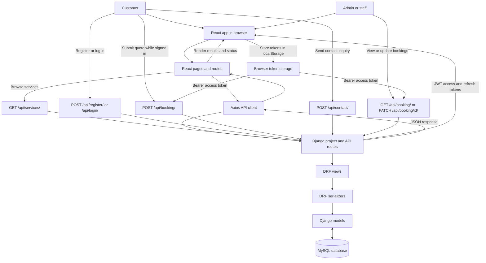

# Secure Shift - Packers & Movers Platform

A full-stack web application for a packers-and-movers business. The project combines a Django REST API backend with a React frontend to handle service browsing, customer registrations, quotation requests, contact submissions, and booking management.

## Project Overview

This application is built in two major sections:

- Backend: Django + Django REST Framework
- Frontend: React + Vite + React Router
- Database: MySQL
- Authentication: Django auth + JWT tokens

The system is designed for a moving company with both public customer screens and private admin management screens.

## Business Goals

The app supports:

- Displaying moving and packing service packages
- Allowing customers to request a quote
- Registering new users
- Logging in to use quote and booking features
- Sending contact inquiries
- Managing customer booking requests in an admin panel
- Updating booking status such as Pending, Confirmed, Completed, and Cancelled

## Detailed Project Structure

```text
PACKERS_MOVERS/
├── backend/
│   ├── appapis/
│   │   ├── __pycache__/
│   │   ├── migrations/
│   │   ├── admin.py
│   │   ├── apps.py
│   │   ├── models.py
│   │   ├── serializers.py
│   │   ├── tests.py
│   │   ├── urls.py
│   │   └── views.py
│   │
│   ├── config/
│   │   ├── __init__.py
│   │   ├── settings.py
│   │   ├── urls.py
│   │   ├── asgi.py
│   │   └── wsgi.py
│   │
│   ├── manage.py
│   └── .gitignore
│
├── packers-movers-frontend/
│   ├── public/
│   ├── src/
│   │   ├── assets/
│   │   ├── components/
│   │   │   └── Header.jsx
│   │   ├── pages/
│   │   │   ├── admin/
│   │   │   │   ├── AdminHome.jsx
│   │   │   │   └── Bookings.jsx
│   │   │   ├── auth/
│   │   │   │   ├── AdminLogin.jsx
│   │   │   │   └── Login.jsx
│   │   │   └── public/
│   │   │       ├── About.jsx
│   │   │       ├── Contact.jsx
│   │   │       ├── Index.jsx
│   │   │       ├── Registration.jsx
│   │   │       ├── RequestQuote.jsx
│   │   │       ├── Search.jsx
│   │   │       └── Services.jsx
│   │   ├── services/
│   │   │   └── api.js
│   │   ├── App.css
│   │   ├── App.jsx
│   │   ├── index.css
│   │   └── main.jsx
│   │
│   ├── .gitignore
│   ├── .oxlintrc.json
│   ├── index.html
│   ├── package.json
│   ├── package-lock.json
│   ├── README.md
│   └── vite.config.js
│
├── README.md
└── .gitignore
```

## Folder-by-Folder Analysis

### 1) Backend (`/backend`)

This folder contains the Django application and API layer.

#### `/backend/appapis`
The core app of the project.

- `models.py`: Defines the database models:
  - `SiteUser`: booking/request data
  - `Services`: service package details
  - `Contact`: customer contact messages
- `serializers.py`: Converts model instances to JSON and validates incoming request payloads
- `views.py`: Contains API logic for services, registrations, login, admin login, bookings, and contact form submission
- `urls.py`: Maps API endpoints to view classes
- `admin.py`: Registers models for Django admin
- `migrations/`: Database migration files generated by Django

#### `/backend/config`
This directory contains Django project configuration.

- `settings.py`: Main settings for database, apps, middleware, CORS, DRF, and JWT config
- `urls.py`: Root URL configuration that includes the app API routes
- `asgi.py` and `wsgi.py`: ASGI/WSGI entry points for running the Django app

#### `/backend/manage.py`
Django management entry point used to run migrations, start the server, create users, and perform admin tasks.

---

### 2) Frontend (`/packers-movers-frontend`)

This folder contains the React application.

#### `/src/components`
- `Header.jsx`: Common site navigation bar with mobile responsiveness, user login/logout handling, admin access button, and registration actions

#### `/src/pages/public`
Public customer-facing pages:

- `Index.jsx`: Landing page with hero section, trust features, CTA blocks
- `Services.jsx`: Displays all services fetched from the backend API
- `About.jsx`: About page or business overview
- `Contact.jsx`: Contact form submission page
- `Registration.jsx`: New user registration form
- `RequestQuote.jsx`: Multi-field request form for moving bookings
- `Search.jsx`: Search page for services or moving needs

#### `/src/pages/auth`
Authentication-related pages:

- `Login.jsx`: User login page
- `AdminLogin.jsx`: Admin authentication page

#### `/src/pages/admin`
Admin interface pages:

- `AdminHome.jsx`: Admin dashboard landing page
- `Bookings.jsx`: Displays all booking requests and allows status updates

#### `/src/services/api.js`
Single Axios instance pointing to the Django API at:

```text
http://127.0.0.1:8000/api/
```

#### `/src/App.jsx`
Main application route definitions using React Router.

## Data Model Summary

### Service Model
The `Services` model stores:

- `title`
- `description`
- `image`
- `price`
- `creationdate`

This is used to populate the services listing page.

### Booking Model (`SiteUser`)
The `SiteUser` model stores customer quote/request information, including:

- name
- email
- mobile
- current location
- destination location
- shifting date
- brief items
- full item details
- remarks
- service reference
- total amount
- advance paid
- payment status
- request date and update date

### Contact Model
Stores customer support/enquiry details:

- name
- contact number
- email
- subject
- message
- date
- read/unread status

## API Structure

The Django backend is mounted under `/api/` from the project root URL configuration.

### Core endpoints

| Method | Endpoint | Access | Purpose |
| --- | --- | --- | --- |
| `GET` | `/api/services/` | Public | Retrieve available moving services. |
| `POST` | `/api/register/` | Public | Register a customer account. |
| `POST` | `/api/login/` | Public | Authenticate a customer and return JWT tokens. |
| `POST` | `/api/admin-login/` | Public | Authenticate an administrator and return JWT tokens. |
| `POST` | `/api/contact/` | Public | Submit a customer contact message. |
| `GET` | `/api/siteusers/` | Authenticated staff | Retrieve all booking records. |
| `GET` | `/api/booking/` | Authenticated staff | Retrieve all booking records. |
| `POST` | `/api/booking/` | Authenticated user | Create a booking/quote request. |
| `PATCH` | `/api/booking/<id>/` | Authenticated staff | Partially update a booking by its ID. |

All endpoints are mounted under `/api/`. Protected endpoints require the access token in the `Authorization: Bearer <access_token>` request header.

## Authentication Flow

The frontend stores JWT tokens in `localStorage` after login:

- `access_token`
- `refresh_token`

The request quote and booking pages send the access token in the `Authorization` header for protected requests.

## Frontend App Behavior

The React app is structured around route-based pages:

- Home page
- Services listing
- About page
- Contact page
- Registration and login
- Request a quote page
- Admin booking dashboard

The header component stays visible across pages and supports navigation and logout behavior.

## Tech Stack Details

| Area | Technology | Purpose |
| --- | --- | --- |
| Backend language | Python | Implements the server-side application. |
| Backend framework | Django 6.1 | Project configuration, routing, and database integration. |
| API framework | Django REST Framework | Builds JSON API endpoints and serializers. |
| Authentication | Django authentication + Simple JWT | Authenticates users and issues JWT access/refresh tokens. |
| Database | MySQL | Stores services, bookings, contact messages, and user records. |
| MySQL driver | PyMySQL | Connects Django to MySQL. |
| Cross-origin requests | django-cors-headers | Allows the local React app to call the API. |
| Frontend library | React 19 | Builds the customer and admin interfaces. |
| Frontend tooling | Vite | Runs the frontend development server and production build. |
| Client-side routing | React Router DOM | Maps URLs to application pages. |
| Styling | Tailwind CSS | Provides utility-based styling. |
| HTTP client | Axios | Sends API requests from the frontend. |
| Icons | Lucide React | Provides interface icons. |

## End-to-End Project Flow

The diagram below shows how customer and admin actions travel through the frontend, API, and database.



## Prerequisites

Before running the project, make sure the following are installed:

- Python 3.10+
- Node.js 18+
- npm
- MySQL Server

## Backend Setup

1. Open a terminal in the `backend` folder.
2. Create a virtual environment:

```bash
python -m venv venv
```

3. Activate the environment:

On Windows:

```bash
venv\Scripts\activate
```

On macOS/Linux:

```bash
source venv/bin/activate
```

4. Install backend dependencies:

```bash
pip install django djangorestframework djangorestframework-simplejwt django-cors-headers pymysql
```

5. Create a MySQL database named `packers_movers`.

6. Update database credentials if needed in:

```text
backend/config/settings.py
```

7. Run migrations:

```bash
python manage.py migrate
```

8. Start the backend server:

```bash
python manage.py runserver
```

The API will be available at:

```text
http://127.0.0.1:8000/api/
```

## Frontend Setup

1. Open a terminal in the `packers-movers-frontend` folder.
2. Install frontend dependencies:

```bash
npm install
```

3. Start the app:

```bash
npm run dev
```

The front-end should run at:

```text
http://localhost:5173
```

## Important Configuration Notes

- The Django settings file currently points to a local MySQL database named `packers_movers`.
- CORS is enabled for the React frontend origin: `http://localhost:5173`.
- The frontend uses the backend API base URL defined in `src/services/api.js`.
- Local token storage is used for client-side login state management.

## Current Project Notes

This project is a practical business application template with a working customer flow and admin panel. It is suitable for learning and extending with additional features such as:

- better role-based access control
- email notifications
- payment gateway integration
- order tracking and delivery status
- file upload improvements
- dashboard analytics

## License

This project does not currently include a dedicated license file. If you plan to distribute or deploy it publicly, consider adding a proper license such as MIT.
